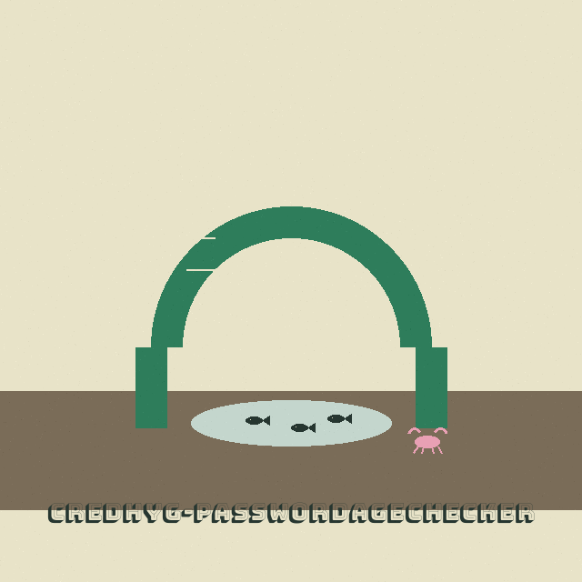

# credhyg-PasswordAgeChecker

Title block: the name above is set in Bungee Shade as the themed label for Mangrove Nursery at Low Tide, with a fine ruled line beneath it. The small mark below stands beside this first heading only; the remaining headings keep the treatment without the image.

# credhyg-PasswordAgeChecker
A command-line tool that checks the age of passwords stored in a specified file (e.g., a KeePass database export). It alerts the user if any password exceeds a configurable age threshold, encouraging password rotation. Alerts and error messages name the account, username, and row number only: a password value is never printed, including for malformed rows and rows with a bad date. - Focused on Tools for identifying and remediating credential leaks, insecure storage, and weak password policies. Checks for exposed API keys, default passwords, and password strength.

## Install

> **Tide board notice: the value is never shown.** Alerts and error messages name the account, the username, and the row number only. A password value is never printed, including for malformed rows and for rows with a bad date.

`git clone https://github.com/ShadowStrikeHQ/credhyg-passwordagechecker`

## Usage

> **Tide board notice: a renamed header is treated as data.** A header row is skipped only when its five cells, stripped and lowered, match the five field names exactly. A header that renames even one column is treated as data and will fail at its date.

`./credhyg-passwordagechecker [params]`

## Parameters

> **Tide board notice: badly dated rows are counted neither way.** A row whose date will not parse is logged as an error, is skipped, and is counted neither as expired nor as sound.

- `-h`: Show help message and exit
- `--max_age`: No description provided
- `--date_format`: No description provided
- `--log_level`: No description provided

## License

> **Tide board notice: a finding exits with status 1.** Where one or more rows exceed the permitted age the run logs how many were found and then exits with status 1.

Copyright (c) ShadowStrikeHQ

## Themed account: facts taken from the code

### What the Tide Brings In

The tool reads a comma separated export whose rows carry five fields in the order name, username, password, url, and creation date. For each row it can read it works out how many days have passed between that creation date and the local date on the machine that runs it, and logs a warning naming the account, the username, and the url whenever that age is greater than the permitted maximum. At no point, in any warning, in any error, or in any summary, does it print the password value itself.

### What Is Left on the Mud

A header row is recognised and skipped only when its five cells, stripped and lowered, match the five field names exactly. A row with any number of fields other than five is skipped with a warning that names the row number and, where the row is long enough to have one, the username, and never the whole row. A row whose date will not parse under the chosen format is logged as an error naming the row number, the account, and the username, is skipped, and is counted neither as expired nor as sound.

### The Value Is Never Shown

This caution has a panel of its own. The code holds the password value in a variable only in order to unpack its row and never sends it to the log. Anyone handing this tool a real export can rely on that restraint.

### Giving and Running

Install line as printed in the README, wrong organisation and all: git clone https://github.com/ShadowStrikeHQ/credhyg-passwordagechecker . Note: the install line names ShadowStrikeHQ, which is not the organisation that holds this repository; the line is shown as printed and flagged here, not corrected inside it. The running form the parser accepts is python3 main.py FILE, with the file path supplied as the first and only positional argument, which is required.

### How Long Before the Mark

Controls in parser order. The help control, shown as -h, prints the help message and leaves. The file path is the path to the comma separated file and it is required. --max_age sets the greatest permitted age in days, must be a positive whole number, and defaults to 90. --date_format gives the pattern by which creation dates are read and defaults to the year month day pattern; a format that cannot be proved against a known date stops the run before any file is touched. --log_level chooses among DEBUG, INFO, WARNING, ERROR, and CRITICAL, and defaults to INFO.

### How the Count Comes Out

Where no row exceeds the permitted age the run finishes normally after logging that none was found. Where one or more rows do exceed it the run logs how many were found and then exits with status 1. Where the file cannot be found, where the reading of it fails, where the maximum age is not a positive whole number, or where the date format is shown to be invalid, the run likewise exits with status 1. The page keeps those two kinds of exit apart in its wording, the one being a report and the other being a failure, even though the number returned is the same.

### Licence

The README offers only a copyright line in the wrong name, preserved verbatim below. The separate LICENSE file in the repository carries the MIT License, with a holder line that carries the owner legal surname, a fact recorded here without that surname being reproduced.

Kit buttons on the site read: Read the Export, Set the Greatest Permitted Age, Set the Date Pattern, Choose the Logging Level, Show Help.
